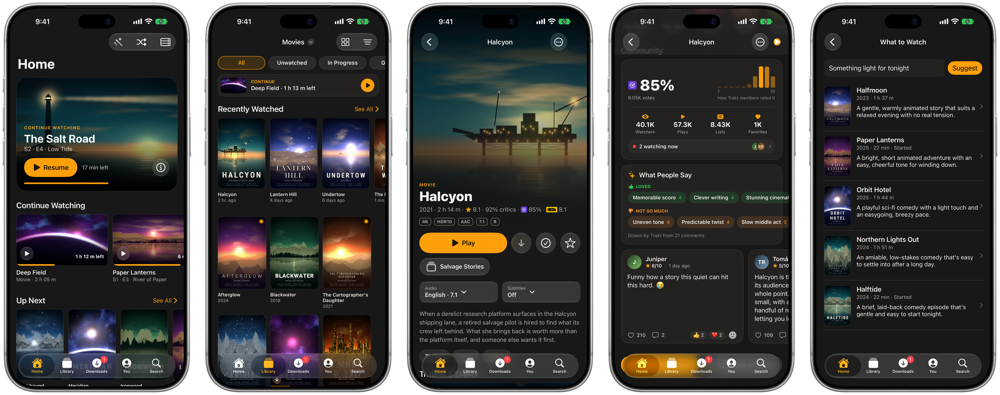

# Crucible

A fast, native Plex client for iPhone, iPad and Apple TV, with a desktop client for Linux in [linux/](linux/README.md). Offline downloads,
Skip Intro, Picture-in-Picture and lock-screen controls on iPhone; a sidebar, windows and keyboard shortcuts on iPad; a
focus-driven Liquid Glass app on Apple TV.

**[Crucible for Plex on the App Store](https://apps.apple.com/us/app/crucible-for-plex/id6822066419)**: free on iPhone,
iPad and Apple TV. Crucible Pro (pay once or yearly; one purchase unlocks every device) adds What to Watch, Previously
On, every Trakt comment and member, unlimited downloads, full Statistics, the Year in Review poster, Top Shelf, Seerr
request management and Library Research. No server yet? Choose *Try the demo* on the welcome screen. The source is
GPL-3.0, and a build from source unlocks every Pro feature except What to Watch and Previously On, which use Crucible's
hosted model.



## What it does

- **Playback**: direct play or HLS transcoding, Skip Intro and Credits, Up Next at the credits, chapters, languages
  remembered per show, a sleep timer, Rewind After a Break, and a place kept through sleep and dropped streams.
- **Downloads**: movies and episodes (whole seasons with Pro) at five qualities, a real background HLS engine with a Live Activity,
  Wi-Fi only by default, and full offline playback with skips and resume.
- **Browse**: a Resume hero, Continue Watching, Up Next, collections, playlists, watchlist, cast filmographies,
  trailers, subtitle search and what your server is missing.
- **Remember**: half-star ratings saved to Plex, Rate What You Watched, Watch History, Statistics, a Year in Review and
  share cards.
- **Integrations**: Trakt (scrobbling, ratings, scores, and each title's community: reviews, replies, reactions, What
  People Say and members to follow) and Seerr, Overseerr or Jellyseerr requests.
- **For server owners**: Manage (Fix Match, Edit Details, artwork, refresh, delete), Stop Stream and the Server
  Dashboard, on every platform.
- **Built right**: Swift 6, programmatic UIKit, Dynamic Type, VoiceOver, Reduce Motion, Plex Home profiles and
  automatic best-route discovery, including Tailscale.

## Crucible Server

An optional companion for the computer that runs Plex ([server/README.md](server/README.md)). Pair it once and Crucible
gets skips from the files themselves, a Previously On recap, answers about what you're watching, and **Library
Research**: your own model looks up the videos in your Other Videos libraries (sports, adult films or anything else)
and gives them real titles, dates, people and posters in Plex, without touching the files, and can take it all back. It uses a model you run (llama-swap, Ollama or LM Studio) or a hosted one
with your own key.

```sh
brew install guitaripod/tap/crucible-server     # macOS
yay -S crucible-server-bin                      # Arch Linux
crucible-server setup                           # signs in to Plex, finds your model, shows the pairing QR code
```

## Building

The iPhone app cross-compiles from Linux with Swift 6 and the iOS SDK, and installs over USB with
[xtool](https://github.com/xtool-org/xtool); [INSTALL.md](INSTALL.md) walks through it.

```sh
swift build --swift-sdk arm64-apple-ios --build-system native
./scripts/install-ios.sh
```

The Apple TV app needs a Mac with Xcode 26 and [XcodeGen](https://github.com/yonaskolb/XcodeGen); [tv/README.md](tv/README.md)
covers the simulator, UI tests and installing on an Apple TV.

## Architecture

One SwiftPM package. `CrucibleCore` (networking, models and every screen's rules, no UIKit) sits under
`CrucibleMedia` (playback), `CrucibleStats` (the watch-history store), `CrucibleDesign` (tokens, glass, images) and
the apps: `Crucible` (iPhone and iPad), `CrucibleTV`, their widget and Top Shelf extensions, and the Linux client.
[docs/ARCHITECTURE.md](docs/ARCHITECTURE.md) has the module graph and the rules. Beyond Apple's frameworks it uses
[GRDB](https://github.com/groue/GRDB.swift) and my MidgarKit (plus swift-crypto on Linux); the server in `server/` is
Rust.
